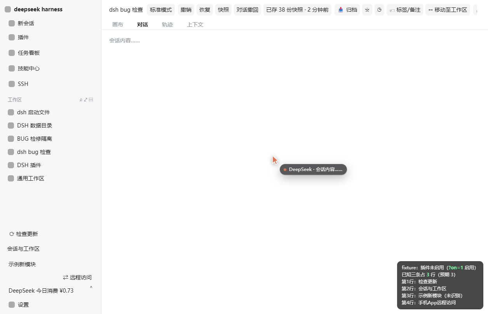
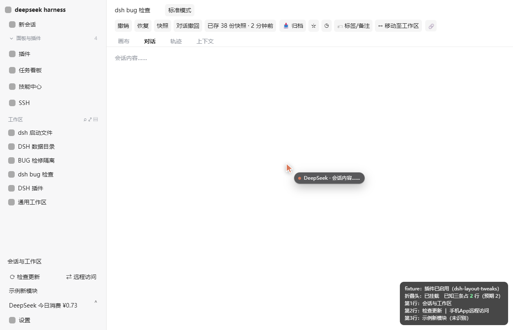
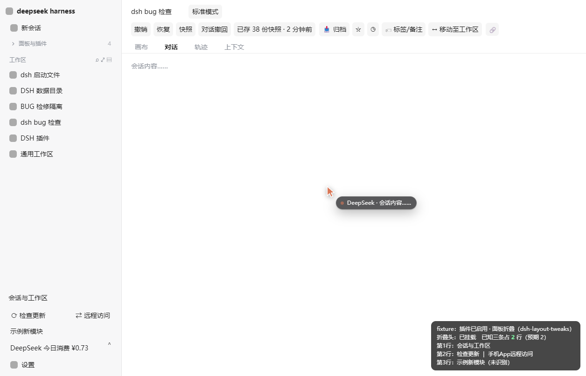

<div align="center">

# dsh-layout-tweaks

**Layout tweaks for the DSH Web GUI — a two-row session header, a collapsible panel list, and a two-row footer**

Render-layer only · touches no other plugin · no build step

[](LICENSE)
[](https://github.com/topics/dsh-plugin)
[](https://dsh.market/)

[中文](README.md) | English

</div>

---

## What it does

Three spots in the DSH Web GUI are awkward:

1. the **session header** crams the title, the working mode and a dozen action buttons into one row;
2. the **panel modules** at the top of the left sidebar (Plugins / Task board / Skill center / SSH) always take up space;
3. the **sidebar footer** is squeezed into three rows by three plugins' competing CSS — *Check for updates*,
   *Session & workspaces* and *Remote access* each get their own row, each with a different alignment.

This plugin fixes all three, and:

- **claims no slot** and **changes no other plugin's code**;
- works purely through injected CSS plus one self-owned collapse header — the React tree never notices;
- ships **prebuilt, hand-written `lib/`** (no tsdown / rolldown / tsc required);
- **fails silently** when an anchor is missing — it can never half-break the host UI.

> ③ touches a **shared** slot (`sidebar.footer.action`): entries are still rendered by their own plugins;
> this one only decides **which row** each entry lands on — no DOM moves, no container changes, no
> width or alignment overrides.

## Features

| # | Feature | Default | Notes |
|---|---------|:-------:|-------|
| ① | **Two-row session header** | on | Row 1 = session title + working mode; row 2 = undo / restore / snapshot / archive / tags / move / copy link; the tab strip stays where it is |
| ② | **Collapsible panel list** | expanded | A collapse header at the top of the sidebar hides Plugins / Task board / Skill center / SSH in one click |
| ③ | **Two-row footer** | on | *Session & workspaces* gets row 1 alone; *Check for updates* and *Remote access* share row 2, **keeping their own alignment** (left / right) |

- ① and ③ are pure CSS (zero DOM writes); ② is a click on the collapse header, instant and remembered.
- **② and ③ are independent**: two switches, two flags (`collapsed` / `footer-layout`).
- When the sidebar collapses to the 56px rail, ③ steps aside — the rail's own vertical stacking applies.

## Preview

| Before (plugin off) | After (plugin on) |
|:------:|:-----:|
|  |  |

- **Header**: `dsh bug 检查` + `标准模式` get row 1 to themselves; every other control moves down a row.
- **Sidebar**: a collapse header (`▾ Panels & plugins 4`) appears above the panel list.
- **Footer**: from three rows → two — *Session & workspaces* on top, then *Check for updates* (left)
  and *Remote access* (right) side by side.

> The footer comparison is a **faithful reproduction**: the fixture ships the three plugins' real CSS,
> so with the plugin off it reliably shows the broken three-row state, and with it on, two rows.

### ② Collapsed



> Screenshots come from the offline fixture `test/fixture.html`, which reproduces the session header,
> left sidebar and footer using the **real DOM shape observed on a live client** — so the layout can be
> verified without signing in to a GUI. A badge in the corner reports the footer's actual row count.

## Install

```bash
dsh plugin --profile web add "github:TowardsDawn/dsh-layout-tweaks"
```

This writes the package into the profile's `dsh.profile.bundles` and lets the bundle layer read its
`cordis.patch.yml`. Or do it manually: add a `file:` dependency plus one entry in
`dsh.profile.bundles` inside `<DSH_HOME>/profiles/web/package.json`, then restart `dsh web`.

This is a **client-only** plugin: the host half (`lib/index.js`) is just a mount point in the assembly
tree — it registers no service and reads no session.

> The client half (`lib/client.js`) is read into memory **at startup** by the host (served with
> `immutable` and a one-year cache), so **editing `lib/client.js` needs a `dsh web` restart** to take
> effect. The day-to-day collapse toggle is unaffected and applies live.

To disable without uninstalling, set `disabled: true` on the inserted row in this package's
`cordis.patch.yml`.

## Configuration

Everything lives in `localStorage` under `dsh-layout-tweaks:v1`:

```json
{ "headerTwoRows": true, "footerLayout": true, "collapsed": false }
```

| Key | Effect |
|---|---|
| `headerTwoRows` | ① two-row session header |
| `footerLayout` | ③ two-row footer |
| `collapsed` | ② panel list folded (written when you click the header) |

### Turning a feature off

Since v0.3.0 the collapse header carries no settings entry (the old ⚙ and its popover are gone); all
three default to on. To disable one, run this in the browser console:

```js
const s = JSON.parse(localStorage.getItem('dsh-layout-tweaks:v1') || '{}')
s.headerTwoRows = false   // or s.footerLayout = false
localStorage.setItem('dsh-layout-tweaks:v1', JSON.stringify(s))
location.reload()
```

Reset everything:

```js
localStorage.removeItem('dsh-layout-tweaks:v1'); location.reload()
```

> The old `foldEntries` / `bottomKeep` fields are no longer read; leaving them in place is harmless.

## How it works

### Why not slots

DSH's slot system makes "rearranging someone else's UI" impossible by design:

1. **`single` slots are exclusive** — `conversation.session.header` is already claimed by
   `@deepseek-ai/dsh-client-ui-conversation`; registering again throws `SlotOwnershipError`.
2. **An entry's disposer recursively removes the child slots it declared** — so force-replacing the
   claim would take the `actions` / `utilities` / `corner` seats (and **every other plugin's buttons**
   in them) down with it.
3. **A `list` entry's render position belongs to the host** — `sidebar.footer.action` and
   `sidebar.panellist` are different slots in different containers, and a registration is bound to its
   slot name.

So this plugin only rearranges at the render layer: no structural changes, no moving React-managed
nodes, no slot claims. Its only DOM write is a single collapse header it owns.

### ① Two rows: a zero-DOM line break

`titleRow` is a flex container. The plugin sets `display:contents` on the `titleCluster` and
`headerActions` wrappers so the breadcrumb and each control become flex items of `titleRow`, then
inserts a line break **without touching the DOM** — the `::after` pseudo-element *is* a flex item:

```css
… > div:first-child{ flex-wrap:wrap }
… > div:first-child::after{ content:""; order:5; flex-basis:100%; height:0 }
… nav{ order:0 }                                          /* session title */
… [data-slot="conversation.session.header.actions"] > *:nth-child(1){ order:1 }   /* working mode */
… [data-slot="conversation.session.header.actions"] > *:nth-child(n+2){ order:10 } /* the rest */
```

### ② The collapse header

The single injected DOM node (`.dsh-lt-head`), created and cleaned up by the plugin: an `insertBefore`
anchor on the sidebar root's `nav` (falling back to the workspaces container), kept in place by a
throttled `MutationObserver`, with text writes guarded against self-triggering. Folding is pure CSS:
`html[data-dsh-lt-collapsed] [data-slot="sidebar"] > div > nav{ display:none }`.

### ③ Two-row footer: order only, appearance untouched

`sidebar.footer.action` is a **shared** `list` slot with three current occupants, each shipping its own
conflicting layout rules:

| Entry | Stable identity | Its own rule |
|---|---|---|
| Session & workspaces | `class*="sm-footerBtn"` | `.sm-footerBtn-wide{ flex:1 1 100% }` **and a `:has()` rule that turns the parent into `flex-wrap:wrap`** |
| Check for updates | `data-dsh-plugin="update"` | `[data-wide=wide]{ flex:auto; justify-content:flex-start }` (capsule when an update exists) |
| Remote access | `data-dsh-plugin="remote-bridge"` | `[data-wide=wide]{ order:1; margin-inline-start:auto }` (always last, always right) |

Together they produce the three rows: the capsule takes row 1, the `100%` entry wraps to row 2, the
`order:1` + `margin-inline-start:auto` entry lands row 3 on the right.

The plugin does exactly two things:

```css
/* 1. make the container wrap (nothing else about it is changed) */
… :where([class*="footerActions"]){ flex-wrap:wrap !important; align-content:flex-start !important; height:auto !important }
/* 2. decide the row with order; width, alignment and looks stay as they are */
… [data-slot="sidebar.footer.action"] > :where(*){ order:3 !important }                      /* baseline: unknown entries last */
… [data-slot="sidebar.footer.action"] > [class*="sm-footerBtn"]{ order:0 !important }        /* row 1, full width */
… [data-slot="sidebar.footer.action"] > [data-dsh-plugin="update"]{ order:1 !important }     /* row 2, left */
… [data-slot="sidebar.footer.action"] > [data-dsh-plugin="remote-bridge"]{ order:2 !important } /* row 2, right */
```

- **Ordering happens inside the original container** — no `display:contents`, no node moves; the
  container keeps its existence and direction (exactly what broke the 0.2.x "fold into the block"
  attempt, see [the appendix](#appendix-an-abandoned-attempt)).
- Selectors use **stable identities only**: `data-dsh-plugin` is a constant the plugins write
  themselves, and `sm-footerBtn` is a hash-free class suffix.
- Unknown entries (future plugins) fall back to a zero-specificity `order:3` baseline, so they land
  after the target rows.
- Only active while the sidebar is **expanded**; collapsed to the rail, the footer is hidden and each
  plugin's own vertical stacking applies.
- Every `order` carries `!important` because a third-party rule
  `[data-dsh-frame]:not(…) [class*="footerActions"] > [data-slot="sidebar.footer.action"] > :not(…) { order: 1 }`
  exists in the wild and would otherwise flatten the result.

### Anchors used

`data-slot="conversation.session.header"` (+ `.actions` / `.utilities` / `.corner`),
`data-slot="sidebar"`, `data-slot="sidebar.workspaces"`, `data-slot="sidebar.footer.action"`, plus the
plugins' own `data-dsh-plugin` attributes and hash-free class suffixes.
**No CSS-Module hashes** (such as `wSkVaW_` / `hHd-Xa_`), which change between releases.

## Appendix: an abandoned attempt

Between v0.1.0 and v0.2.4 this plugin also tried to **move** the sidebar's bottom entries up under the
panel list and into the fold. **v0.3.0 removed that machinery entirely**, because the cost far
outweighed the benefit (one screen of space):

1. **Bottom entries and the panel list are registered very differently** — different slots, different
   containers, different layout constraints. "Fold them in" can only be faked by flattening the whole
   container chain with `display:contents`; fragile by construction.
2. **`order` applies to the *layout* flex item, while selectors follow the *DOM* hierarchy.**
3. **Flattening a container changes the container's own flex direction** — the expensive one: `flex:1`
   went from "fill the width" to "grab height", stretching an entry to 125px and squeezing the workspace
   list to zero ("the workspace list disappeared").
4. **Someone else may already be ordering the same entries** (a `(0,6,0)` third-party rule) — hence
   `!important` everywhere.
5. **The baseline rule's specificity can beat the classification rules** — hence `:where()`.

Two conclusions:

- **Never move**: cross-container "fold into the block" is abandoned for good — it must change the
  container's existence and direction.
- **Ordering is fine**: ③ only sets `order` **inside the original container**, so items 2–3 no longer
  apply; the lessons from 4–5 are reused directly.

`npm test` guards the boundary with reverse assertions: `data-dsh-lt-fold` / `data-dsh-lt-keep` /
`data-dsh-lt-box` / `data-dsh-lt-settings` / `BOTTOM_KEEP_SELECTORS` must never reappear.

## Compatibility

- Host: DSH Web client (DOM shape verified against the 0.2.1-rc series).
- Browser: anything with `:has()` (Chrome / Edge 105+, Firefox 121+, Safari 15.4+).
- Degradation: without `:has()` the `@supports` guard disables ① and ③; ② keeps working.
- Node (install time only): ≥ 22.19.

## Known limitations

- Tied to the host DOM shape; a major DSH restructure makes the rules miss (the plugin goes inert
  rather than erroring — update the selectors).
- **③ relies on two third-party identities** (`data-dsh-plugin="update"` / `"remote-bridge"` and the
  `sm-footerBtn` class suffix). If an author renames them, those rules silently stop applying — the
  footer simply returns to its original look, nothing breaks.
- **③ only decides *which row*** — width and alignment still come from the entries' own plugins.
- The collapse header assumes the sidebar root's first `nav` is the panel list.
- The two-row header assumes the first item of `actions` is the working mode.

## FAQ

<details>
<summary><b>Does it affect other plugins?</b></summary>

It changes none of their code, registrations or rendered nodes. Its only DOM write is one collapse
header it owns (removed on unload); ③ merely orders entries inside a shared slot — width, alignment and
looks are untouched.
</details>

<details>
<summary><b>Why not a proper slot plugin?</b></summary>

See [How it works](#why-not-slots) — exclusive `single` slots, cascade-disposed child slots, and
host-owned `list` positions make "rearranging someone else's UI" impossible at the slot layer.
</details>

<details>
<summary><b>Are ② and ③ the same thing?</b></summary>

No. ② folds the **panel list at the top** (`sidebar.panellist`'s `nav`); ③ orders the **footer action
row** (`sidebar.footer.action`). Two independent switches: `collapsed` and `footerLayout`.
</details>

<details>
<summary><b>Why keep the "abandoned attempt" appendix?</b></summary>

Because it explains the difference between ③ and the old approach: the old "fold into the block" had to
flatten containers and flip a container's flex direction; ③ only orders inside the existing container.
</details>

<details>
<summary><b>Do I need to restart DSH?</b></summary>

Editing `lib/client.js` (and installing/uninstalling) does — the client half is read into memory at
startup and served with a long cache. The collapse toggle does not: it applies live and is remembered.
</details>

<details>
<summary><b>How do I restore the original layout?</b></summary>

Clear `dsh-layout-tweaks:v1` from `localStorage` (or turn features off as shown in
[Configuration](#configuration)). To remove it at the assembly level, see *Install*.
</details>

<details>
<summary><b>How can I verify ③ works?</b></summary>

Open the fixture at `test/fixture.html?on=1`; the badge reports **"known three occupy 2 rows
(expected 2)"** and lists each row (row 1: Session & workspaces; row 2: Check for updates | Remote
access). Drop `?on=1` to see the broken three-row state for comparison.
</details>

## Development

No build step — `lib/` is the artifact:

```bash
# offline pre-flight (syntax / module protocol / factory export / host half /
#   footer selectors / legacy-move reverse assertions / required files — 28 checks)
# — this is what catches the classic client-plugin failure: the whole stylesheet lives in a template
#   literal, so a stray backtick in a comment terminates it and the module fails to import in DSH
npm test

# offline fixture (no GUI sign-in needed)
#   test/fixture.html                  → plugin off  (before)
#   test/fixture.html?on=1             → plugin on   (after)
#   test/fixture.html?on=1&collapsed=1 → plugin on, panel list folded
```

**Run `npm test` before pushing** — client-plugin mistakes only surface in the browser, and this script
needs neither DSH nor a browser.

The fixture reproduces the three plugins' real CSS rules, so the regression is honest: **three rows off,
two rows on**, reported live by the badge.

## License

[MIT](LICENSE)
