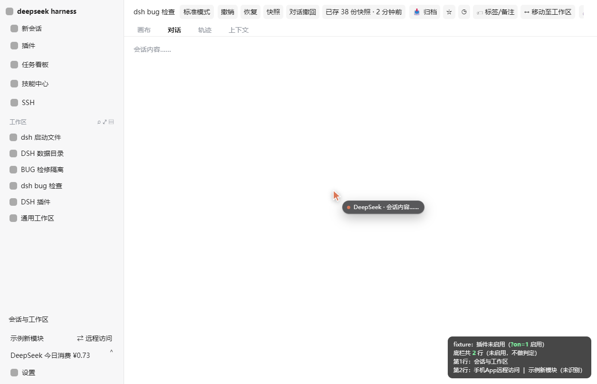
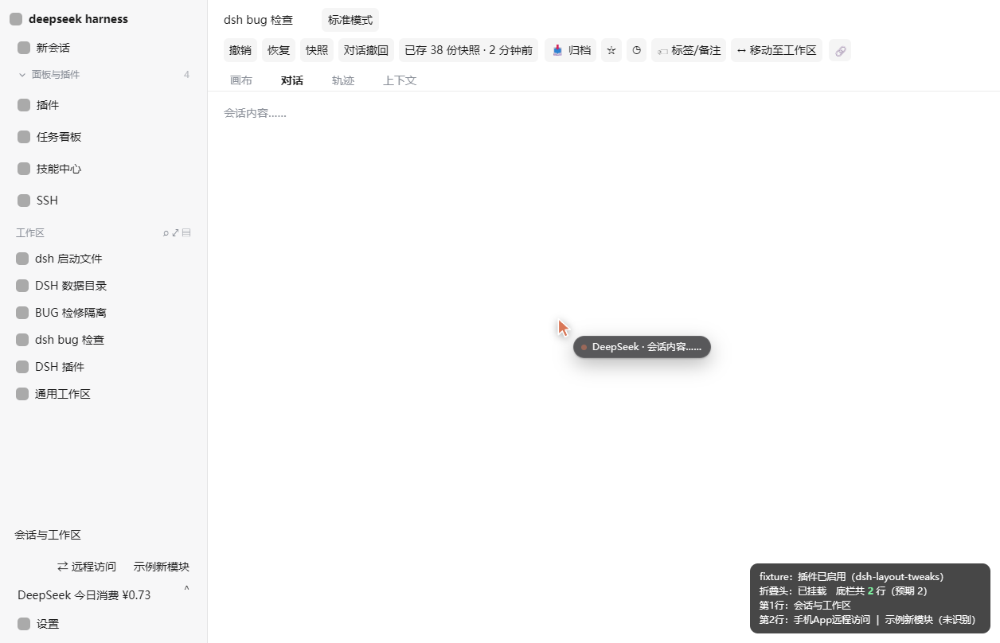
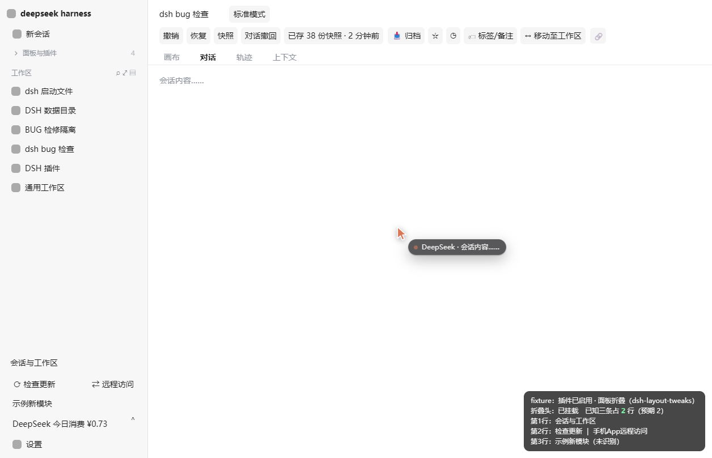

<div align="center">

# dsh-layout-tweaks

**DSH Web GUI 布局微调 —— 会话头两行、面板列表折叠、底栏入口两行排布**

纯渲染层实现 · 不修改任何其他插件 · 免构建

[](LICENSE)
[](https://github.com/topics/dsh-plugin)
[](https://dsh.market/)

[功能](#功能) · [效果](#效果) · [安装](#安装) · [配置](#配置) · [工作原理](#工作原理) · [被放弃的尝试](#附录一次被放弃的尝试) · [兼容性](#兼容性) · [FAQ](#faq)

[English](README.en.md) | 中文

</div>

---

## 这是什么

DSH Web GUI 里有三处布局上的不便：

1. **会话头上边栏**把会话名、工作模式和十几个操作按钮挤在同一行；
2. **左侧栏顶部的面板模块**（插件、任务看板、技能中心、SSH）始终占着位置；
3. **左侧栏底部的动作行**由多个插件各自的 CSS 拼出来 —— 谁占一行、谁靠左谁靠右全看各自下发的规则，插件一多就挤成参差不齐的多行。

`dsh-layout-tweaks` 用一个客户端插件处理这三处，且：

- **不接管任何 slot**、**不修改其他插件的任何代码**；
- 全部通过注入 CSS（外加一个自建的折叠头）完成，React 渲染树零感知；
- **免构建**：`lib/` 直接手写可加载产物，不需要 tsdown / rolldown / tsc；
- 找不到锚点时**静默失效**，绝不会把宿主界面改坏。

> ③ 处理的是一个**多方共享**的槽位（`sidebar.footer.action`）：条目仍由各插件自己渲染，
> 本插件只决定它们落在第几行 —— **不搬 DOM、不改容器结构、不动宽度与对齐**。

## 功能

| # | 功能 | 默认 | 说明 |
|---|------|:----:|------|
| ① | **会话头拆两行** | 开 | 第 1 行 = 会话名 + 工作模式；第 2 行 = 撤销 / 恢复 / 快照 / 对话撤回 / 归档 / 标签备注 / 移动至工作区 / 复制链接等其余控件；页签行保持不变 |
| ② | **面板列表折叠** | 展开 | 侧栏顶部新增折叠头，一键收起「插件 / 任务看板 / 技能中心 / SSH」，把空间让给工作区与会话列表 |
| ③ | **底栏两行排布** | 开 | 「会话与工作区」独占第 1 行；其余动作（远程访问等）统一排第 2 行，**各自保留原有对齐** |

- ① 与 ③ 是纯 CSS，无任何 DOM 写入；② 点击折叠头本体，状态即时生效并记忆。
- **② 与 ③ 互相独立**：两个开关、两个 flag（`collapsed` / `footer-layout`），折叠顶栏不影响底栏排布，反之亦然。
- 侧栏收起成 56px 轨道时，③ 自动让位（轨道态由各插件自己的竖排逻辑负责）。

## 效果

### Before → After

| Before（未启用） | After（已启用） |
|:------:|:-----:|
|  |  |

- **会话头**：`dsh bug 检查` + `标准模式` 独占第一行，其余控件整体下移一行。
- **侧栏**：面板列表上方多了一个折叠头 `▾ 面板与插件 4`。
- **底栏**：`会话与工作区` 独占第一行，其余动作统一排第二行（远程访问靠右）；
  将来新插件注册进来的入口也会自动落到第二行，不会各自插乱。

> 底栏这张对比是**真实现象的复刻**：夹具里如实复刻了这些插件各自的 CSS，
> 夹具里的「示例新模块」模拟一个未来插件：它会被归位到第二行，而不是自己另起一行。

### ② 折叠



> 示意图由仓库内的离线夹具 `test/fixture.html` 渲染 —— 它用**实测的 DSH 客户端 DOM**（class 名与层级取自真机核对）复刻了会话头、左侧栏与底栏，因此不用登录 GUI 也能验证布局。右下角浮层会直接报出底栏的实际行数与每行成员。

## 安装

### 方式一：用 `dsh plugin` 命令（推荐）

```bash
dsh plugin --profile web add "github:TowardsDawn/dsh-layout-tweaks"
```

该命令会把本包写进 profile 的 `dsh.profile.bundles`，并让 bundle 层读取本包的 `cordis.patch.yml`。

### 方式二：手动挂载

1. 把本目录放到任意位置（例如 `<DSH插件目录>/dsh-layout-tweaks`）；
2. 编辑 `<DSH_HOME>/profiles/web/package.json`：

   ```jsonc
   {
     "dependencies": {
       "dsh-layout-tweaks": "file:<本目录绝对路径>"
     },
     "dsh": {
       "profile": {
         "bundles": [
           // …其他插件…
           "dsh-layout-tweaks"
         ]
       }
     }
   }
   ```

3. 重启 `dsh web`。

> 本插件是**纯客户端**插件：host 半（`lib/index.js`）只是装配树里的挂载点，不注册服务、不读取会话。
>
> 注意：客户端半（`lib/client.js`）是被宿主**在启动时读入内存**的（响应头带 `immutable` + 一年缓存），所以**改动 `lib/client.js` 之后需要重启 `dsh web` 才会生效**；日常的折叠开关不受影响，即时生效。

### 临时停用（不卸载）

编辑本包 `cordis.patch.yml`：

```yaml
- insert:
    - id: dsh-layout-tweaks
      name: 'dsh-layout-tweaks'
      disabled: true
```

### 卸载

删掉 `dsh.profile.bundles` 里的那一行与对应依赖即可。插件在卸载时会自行移除注入样式、自建节点与 `<html>` 上的状态属性。

## 配置

所有开关都记在浏览器 `localStorage` 的 `dsh-layout-tweaks:v1`：

```json
{ "headerTwoRows": true, "footerLayout": true, "collapsed": false }
```

| 键 | 作用 |
|---|---|
| `headerTwoRows` | ① 会话头两行 |
| `footerLayout` | ③ 底栏两行排布 |
| `collapsed` | ② 面板列表是否折叠（点折叠头时自动写入） |

### 折叠面板列表（②）

点折叠头即可。等价于设置 `collapsed`。

### 关掉某一项

v0.3.0 起折叠头上不再挂设置入口（原来的 ⚙ 与弹层已移除），三项默认全开。要关掉任意一项，在浏览器控制台执行：

```js
const s = JSON.parse(localStorage.getItem('dsh-layout-tweaks:v1') || '{}')
s.headerTwoRows = false   // 或 s.footerLayout = false
localStorage.setItem('dsh-layout-tweaks:v1', JSON.stringify(s))
location.reload()
```

恢复默认（全开）：

```js
localStorage.removeItem('dsh-layout-tweaks:v1'); location.reload()
```

> 旧版本留下的 `foldEntries` / `bottomKeep` 字段已不再被读取，留着无影响。

## 工作原理

### 为什么不走 slot

DSH 的 slot 系统对「重排别人的 UI」有三个硬约束（详见 `@deepseek-ai/dsh-client-ui-slots` 的设计）：

1. **`single` 槽位独占、声明即认领**：`conversation.session.header` 已被 `@deepseek-ai/dsh-client-ui-conversation` 自己注册占据，再注册会抛 `SlotOwnershipError`。
2. **条目的 disposer 会递归移除它声明的子槽**：即使强拆原注册再顶替，`actions` / `utilities` / `corner` 三个子槽连同**其他插件**注册的按钮会一起消失。
3. **`list` 条目的渲染位置由宿主决定**：`sidebar.footer.action` 与 `sidebar.panellist` 是两个不同的槽位与容器，注册对象绑定槽位名，跨容器搬移不可能。

因此本插件只做「渲染层重排」：**不改结构、不搬 React 节点、不抢槽位**。它对 DOM 的全部写入只有一个属于自己的折叠头节点。

### ① 会话头拆两行：零 DOM 注入的断行符

真实 DOM（`data-slot` 锚点是 `display:contents` 的透明包装，所以 `titleRow`/`tabs` 直接参与 `<header>` 的 grid）：

```html
<header class="…_header" style="display:grid; grid-template-columns:auto minmax(0,1fr)">
  <div class="…_headerLeading"></div>
  <div data-slot="conversation.session.header" style="display:contents">
    <div class="…_titleRow">
      <div class="…_titleCluster">
        <nav class="…_crumbs">会话名</nav>
        <div class="…_headerActions">
          <div data-slot="conversation.session.header.actions" style="display:contents">
            <span>标准模式</span>  ← agent-preset，order:-10，恒定第一个
            <div>撤销 / 恢复 / 快照 …</div>
            <div>归档 / 标签 / 移动 …</div>
          </div>
        </div>
      </div>
      <div class="…_headerUtilities"></div>
      <div class="…_headerCorner"></div>
    </div>
    <div class="…_tabs" role="tablist"></div>
  </div>
</header>
```

做法：

```css
/* 拆掉 titleCluster / headerActions 两层盒子，让 crumbs 与各控件成为 titleRow 的 flex item */
… > div:first-child{ flex-wrap:wrap }
… > div:first-child > div:has(> nav){ display:contents }
… div:has(> [data-slot="conversation.session.header.actions"]){ display:contents }
/* 零宽断行符：伪元素本身就是 titleRow 的一个 flex item */
… > div:first-child::after{ content:""; order:5; flex-basis:100%; height:0 }
/* 排序 */
… nav{ order:0 }
[data-slot="conversation.session.header.actions"] > *:nth-child(1){ order:1 }   /* 工作模式 */
[data-slot="conversation.session.header.actions"] > *:nth-child(n+2){ order:10 }
… headerUtilities{ order:11 }  … headerCorner{ order:12 }
```

`::after` 伪元素的妙处：它天然是宿主元素内部的 flex item，因此**不需要往 DOM 里插任何节点**就能造出断行点，React reconciliation 完全无感。

### ② 折叠头

唯一注入的 DOM 节点（`.dsh-lt-head`），由插件自己创建、自己插入、自己清理：

- 定位锚点：侧栏根的直接子元素 `nav`（面板列表），退化为工作区区容器；用 `insertBefore` 放在它前面，**不移动任何 React 管理的节点**；
- 收起动作是纯 CSS：`html[data-dsh-lt-collapsed] [data-slot="sidebar"] > div > nav{ display:none }`；
- 维护方式：`MutationObserver`（`documentElement` + `subtree`）＋ `requestAnimationFrame` 节流，确保 SPA 重挂载后回到位；
- 自激防护：文本只在真的变化时写入（否则 `textContent` 赋值会再次触发 observer）；
- 侧栏收起为 56px 轨道时由 CSS 隐藏（`[class*="collapsed"]`）。

### ③ 底栏两行：只管顺序，不碰外观

`sidebar.footer.action` 是**多方共享**的槽位（`kind: 'list'`），目前有三个占用者，它们各自带一套互相冲突的布局规则：

| 条目 | 身份标识 | 自带的布局规则 |
|---|---|---|
| 会话与工作区 | `class*="sm-footerBtn"` | `.sm-footerBtn-wide{ flex:1 1 100% }`，并用 `:has()` **把父容器改成 `flex-wrap:wrap`** |
| 手机App远程访问 | （不在本插件规则里） | `{ order:1; margin-inline-start:auto }`（自己排最后并靠右） |
多条规则叠加就容易参差不齐：`flex:1 1 100%` 的条目要独占一行，带 `order` 的又要抢位置，插件每多一个就多一分错位的可能。

本插件只做两件事：

```css
/* 1. 保证容器可换行（其余一律不动） */
… :where([class*="footerActions"]){ flex-wrap:wrap !important; align-content:flex-start !important; height:auto !important }
/* 2. 用 order 决定谁在第几行；宽度、对齐、外观全部保留原样 */
… [data-slot="sidebar.footer.action"] > :where(*){ order:3 !important }              /* 基线：未识别的排最后 */
… [data-slot="sidebar.footer.action"] > [class*="sm-footerBtn"]{ order:0 !important }      /* 第 1 行独占 */
… [data-slot="sidebar.footer.action"] > [data-dsh-plugin="update"]{ order:1 !important }   /* 第 2 行，左 */
… [data-slot="sidebar.footer.action"] > [data-dsh-plugin="remote-bridge"]{ order:2 !important } /* 第 2 行，右 */
```

- **排序在原有容器内完成**，没有 `display:contents`、没有搬节点 —— 容器还是那个容器，方向还是那个方向（这正是 0.2.x 那套「搬进折叠块」失败的根源，见[附录](#附录一次被放弃的尝试)）。
- 选择器只用**稳定标识**：`data-dsh-plugin` 是插件自己写在元素上的常量，`sm-footerBtn` 是无 hash 的类名后缀；不使用会随打包变化的 CSS Module 前缀。
- 未识别的条目（未来新插件）走零特异性基线 `order:3`，排在最后一行之后，不会被挤进目标两行。
- 只在**侧栏展开**时接管（`[data-slot="sidebar"] > div:not([class*="collapsed"])`）；收起成 56px 轨道时底部区域整体隐藏，各插件有自己的竖排逻辑，本插件不参与。
- 所有 `order` 都带 `!important`：真机上还有一条第三方规则 `[data-dsh-frame]:not(…) [class*="footerActions"] > [data-slot="sidebar.footer.action"] > :not(…) { order: 1 }`，不加会被它整片覆盖。

### 使用的 DOM 锚点

| 用途 | 锚点 |
|------|------|
| 会话头槽位 | `[data-slot="conversation.session.header"]` |
| 头部控件槽位 | `[data-slot="conversation.session.header.actions" / `.utilities` / `.corner`]` |
| 侧栏宿主 / 根 | `[data-slot="sidebar"]` → 其第一个子元素 |
| 面板列表 | 侧栏根的直接子元素 `nav` |
| 工作区区（折叠头兜底锚点） | 侧栏根的子元素 `div:has(> [data-slot="sidebar.workspaces"])` |
| 底栏槽位 | `[data-slot="sidebar.footer.action"]`（其直接子元素即各条目） |

全部为 **`data-slot` 属性、插件自带的稳定属性与类名后缀**，**不使用会随版本变化的 CSS Module hash 前缀**（如 `wSkVaW_` / `hHd-Xa_`）。

## 附录：一次被放弃的尝试

v0.1.0 → v0.2.4 之间，本插件还做过一件事：把侧栏底部的「上下文洞察 / 会话管理」这类功能入口**搬到面板列表下方，并收进折叠块**。**v0.3.0 把它整套删掉了**，因为收益（少占一屏）远小于代价。留下的教训写在这里，免得以后重蹈：

1. **底部入口与面板列表的注册方式差异很大。** 它们属于不同的槽位、住在不同的容器里、受不同的布局约束；「并入折叠块」只能靠在渲染层把整条容器链拆成 `display:contents` 来伪造，天生脆弱。
2. **`order` 作用于「布局」上的 flex item，而选择器必须按「DOM 层级」书写。** `display:contents` 只让容器在布局上透明，它在 DOM 里仍是那些条目的父元素 —— 一开始把选择器写成直接子级，结果匹配不到任何条目，它们保持默认 `order:0` 全部堆到侧栏顶上。
3. **拆掉容器盒子会连带改变容器自身的 flex 方向。** 这是最贵的一个坑：底部入口原本待在横向容器里靠 `flex:1` 占满宽度，被搬进侧栏根（纵向容器）后，同一个 `flex:1` 变成「**抢占高度**」—— 实测入口被撑到 125px（正常 36px），工作区列表被挤到 0 高度，表现是「工作区/会话列表不见了」。
4. **同一批条目可能已经被别的插件排序了。** 实测有另一个插件（用 `data-dsh-frame` / `data-dsh-part` 标记侧栏）下发 `[data-dsh-frame]:not(…) [class*="footerActions"] > [data-slot="sidebar.footer.action"] > :not(…) { order: 1 }`，特异性 `(0,6,0)`，比本插件的 `(0,3,1)` 高，会把分类结果整片压掉。最终只能靠清一色 `!important` 对抗。
5. **基线规则的特异性会反噬分类规则**，得靠 `:where()` 把基线压到零特异性才压得住。

结论分两条：

- **不搬**：跨容器的「并入折叠块」永久放弃 —— 它必须改变容器的存在与方向，代价（布局脆弱、挤掉工作区）远大于收益。
- **可以排**：v0.4.0 的 ③ 只在**原容器内**用 `order` 决定行，不拆盒子、不搬节点，因此上面第 2、3 条坑不再适用；第 4、5 条的经验则直接复用（`!important` + `:where()` 基线）。

`npm test` 里有一组反向断言专门盯着这条边界：`data-dsh-lt-fold` / `data-dsh-lt-keep` / `data-dsh-lt-box` / `data-dsh-lt-settings` / `BOTTOM_KEEP_SELECTORS` 一旦重新出现，测试直接失败。

## 兼容性

| 项目 | 要求 |
|------|------|
| 宿主 | DSH Web 客户端（DOM 形态基于 0.2.1-rc 系列实测） |
| 浏览器 | 支持 `:has()` 的现代浏览器（Chrome / Edge 105+、Firefox 121+、Safari 15.4+） |
| 降级 | 不支持 `:has()` 时 ① 与 ③ 被 `@supports` 挡下，插件静默不生效；② 折叠仍可用（它不依赖 `:has()`） |
| Node（仅安装时） | ≥ 22.19 |

## 已知限制

- **依赖宿主 DOM 形态**：DSH 大版本若重构会话头或侧栏结构，规则会失配。此时表现是「插件不生效」而不是报错；更新选择器即可。
- **③ 依赖两个第三方标识**：`data-dsh-plugin="update"` / `data-dsh-plugin="remote-bridge"` 与类名后缀 `sm-footerBtn`。若作者改名，这两条规则会静默失效（底栏退回原样，不会变坏）—— 届时改一行选择器即可。
- **③ 只保证「谁在第几行」**：条目的宽度与对齐仍由各插件决定。若某个插件将来把 `flex` 改成需要独占整行的值，它会自动换到下一行（基线 `order:3` 保证不会被排进目标两行）。
- **折叠头假设侧栏根的第一个 `nav` 就是面板列表**（找不到时退化为工作区区容器）。
- **顶部两行假设 `actions` 的第一项是工作模式**（它本身带 `order:-10`，恒定第一个）。
- **会话头第 2 行是普通 flex 行**（`flex-wrap`）：窗口很窄或注册了很多头部按钮时会自然溢出到更多行，这是刻意行为，保证控件不被裁切。

## FAQ

<details>
<summary><b>会影响其他插件吗？</b></summary>

不会改它们的代码、注册或渲染的节点。对 DOM 的唯一写入是一个属于自己的折叠头节点（卸载时移除）；③ 只是给共享槽位里的条目排了个序，宽度、对齐、外观一律不动。
</details>

<details>
<summary><b>为什么不做成标准的 slot 插件？</b></summary>

见[工作原理](#为什么不走-slot) —— `single` 槽位独占、子槽级联销毁、list 条目位置由宿主决定，这三条让「重排别人的 UI」在 slot 层无法实现。渲染层重排是唯一不牵连其他插件的做法。
</details>

<details>
<summary><b>③ 和 ② 是一套吗？</b></summary>

不是。② 折叠的是**顶部的面板列表**（`sidebar.panellist` 所在的那条 `nav`），③ 排的是**底部的动作行**（`sidebar.footer.action`）。两个独立开关：`collapsed` 与 `footerLayout`。
</details>

<details>
<summary><b>为什么还保留「附录：一次被放弃的尝试」？</b></summary>

因为那段历史解释了 ③ 与旧方案的本质区别：旧的「并入折叠块」要拆容器盒子并改变容器 flex 方向，代价极大；新的 ③ 只在原容器里排序。写清楚，免得以后有人再走一遍。
</details>

<details>
<summary><b>改完要重启 DSH 吗？</b></summary>

改 `lib/client.js` 需要重启 `dsh web`（客户端半在启动时被读入内存并带长缓存）；安装/卸载同理。日常的折叠开关**不需要**，即时生效并自动记忆。
</details>

<details>
<summary><b>怎么完全恢复原样？</b></summary>

清掉 `localStorage` 的 `dsh-layout-tweaks:v1`（或按[配置](#配置)逐项关闭），页面即回到宿主原生布局。要在装配层面彻底移除，见[安装](#安装)里的「卸载」。
</details>

<details>
<summary><b>怎么确认 ③ 生效了？</b></summary>

打开离线夹具 `test/fixture.html?on=1`，右下角会报「底栏行数：2（预期 2）」并列出每行成员（第1行：会话与工作区；第2行：手机App远程访问｜示例新模块）。
</details>

## 开发

本插件**免构建**，`lib/` 即产物：

```bash
# 离线预检（语法解析 / 模块注册协议 / factory 导出 / host 半 /
#          底栏选择器正向断言 / 旧搬运机制反向断言 / 必需文件，共 28 项）
# —— 客户端插件最容易翻车的一类错误会在这里被拦下：整段 CSS 活在一个模板字符串里，
#    注释里误用反引号会提前终止它，模块 import 失败（DSH 界面报 "import failed"）
npm test

# 离线夹具：用实测 DOM 复刻件验证布局（无需登录 GUI）
#   test/fixture.html                  → 关闭插件（before）
#   test/fixture.html?on=1             → 启用插件（after）
#   test/fixture.html?on=1&collapsed=1 → 启用并折叠面板列表
```

**push 前请先跑 `npm test`**：客户端插件的错误只会在浏览器里炸，而这个脚本不需要 DSH、也不需要浏览器。

夹具里复刻了这些插件的真实 CSS 规则（session-manager 的 `:has()` 换行 + `flex:1 1 100%`、remote-bridge 的 `order:1` + `margin-inline-start:auto`），右下角浮层直接报底栏行数：**开启插件后必须恰好 2 行**。

## 目录结构

```
dsh-layout-tweaks/
├─ lib/
│  ├─ index.js          # host 半：空挂载点
│  └─ client.js         # 浏览器半：两行头部 + 折叠头 + 底栏排布（免构建）
├─ test/
│  ├─ fixture.html      # 离线夹具（实测 DOM 复刻 + 行数自检）
│  └─ smoke.mjs         # 离线预检（npm test）
├─ assets/              # README 截图
├─ cordis.patch.yml     # bundle patch：把插件挂进装配树
├─ package.json
├─ CHANGELOG.md
└─ LICENSE
```

## License

[MIT](LICENSE)
